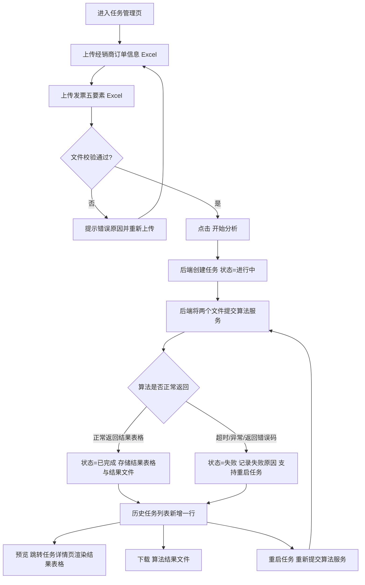

# 审计风险任务管理平台 · 产品需求文档（PRD）

## 1. 产品概述

面向审计与财务合规场景的轻量级任务管理平台。用户上传「经销商订单信息」与「发票五要素」两类 Excel 文件，平台把任务与数据转交算法服务（风险规则引擎）分析，并回收结果表格用于回显、预览与下载。

- **解决的问题**：经销商订单与发票人工逐条比对效率低、口径不一致、易遗漏，且过程无法追溯。
- **目标用户**：企业审计专员、财务合规人员。
- **产品价值**：让每一次票据核查「可发现」（风险识别）、「可追溯」（历史任务）、「可复用」（结果下载）、「可重跑」（重启任务）。
- **边界**：风险判定逻辑由算法团队的规则引擎负责，本平台只做**任务的收集、转发、结果回收与展示**，不内置业务规则。

## 2. 核心功能

### 2.1 用户角色

| 角色 | 登录方式 | 核心权限 |
| ---- | -------- | -------- |
| 审计专员 | 免登录；页面右上角可切换当前身份（演示用，用于产生不同「发起人」） | 新建任务、查看/预览/下载历史任务、重启任务 |
| 算法服务（外部系统） | 无需登录，由平台后端通过内网接口调用 | 接收两个 Excel 与任务标识，返回分析结果表格与结果文件 |

### 2.2 功能模块

1. **任务管理页（`/`）**：品牌导航栏、新建任务区（双文件上传 + 开始分析）、历史任务区（关键词搜索 + 任务表格 + 行操作）
2. **任务详情页（`/tasks/:id`）**：分析概览、结果表格（按算法返回列动态渲染）、源文件信息、预览与下载操作

### 2.3 页面详情

| 页面名称 | 模块名称 | 功能描述 |
| -------- | -------- | -------- |
| 任务管理页 | 品牌导航栏 | 展示产品标识与当前登录身份；提供身份切换入口；展示「任务总数 / 发现风险任务数」轻量统计 |
| 任务管理页 | 新建任务区 | ① 上传「经销商订单信息」Excel（.xlsx/.xls），支持点击选择与拖拽上传，展示文件名/大小，可移除重传；② 上传「发票五要素」Excel，能力同上；③ 点击【开始分析】校验文件完整性后创建任务并提交算法服务，任务进入「进行中」，展示实时进度；④ 提供「下载模板」入口，下载两类文件的示例模板 |
| 任务管理页 | 历史任务区 | 表格列：发起人、任务启动时间、是否发现风险、任务状态、操作；支持分页；空态、加载骨架屏；存在「进行中」任务时自动轮询刷新状态 |
| 任务管理页 | 关键词搜索 | 位于历史任务区右上方；输入关键词后对表格**所有字段**（发起人、启动时间、风险结论、任务状态、文件名等）做包含匹配过滤；提供清空按钮与结果计数提示 |
| 任务管理页 | 行操作 · 预览 | 跳转任务详情页查看算法返回的结果表格；「进行中」任务不可预览（置灰并提示） |
| 任务管理页 | 行操作 · 下载 | 下载该任务的**算法结果文件**；若算法未回传文件，则由后端按结果表格生成 xlsx 下载；「进行中/失败」任务不可下载 |
| 任务管理页 | 行操作 · 重启任务 | 重置任务状态为「进行中」并重新提交源文件给算法服务，完成后覆盖结果并刷新时间与风险结论 |
| 任务详情页 | 分析概览卡片 | 展示算法返回的汇总指标（风险总数、各等级数量、金额与差异等）；指标项按算法 `summary` 动态渲染 |
| 任务详情页 | 结果表格 | 完全按算法返回的 `columns` + `rows` 动态渲染，列名、列数、字段均由算法决定；支持按关键词过滤与列排序 |
| 任务详情页 | 源文件信息与操作 | 展示两个源文件名与解析行数、算法服务状态；提供【下载分析结果】【重启任务】【返回列表】 |

## 3. 核心流程

用户在任务管理页上传两类 Excel → 校验通过后点击【开始分析】→ 后端创建任务（进行中）并把两个文件提交算法服务 → 算法服务返回结果表格（与结果文件）→ 后端落库并置任务为已完成（算法异常则置失败）→ 前端回显结果，支持预览与下载；对任意历史任务可重启以重新分析。

## 4. 界面设计

### 4.1 设计风格

- **整体定位**：现代企业级数据产品的「克制 + 精致」路线，避免通用后台模板感。
- **主色 / 辅色**：主色深靛蓝 `#2E5BFF`（悬停 `#1E47E0`，浅底 `#EEF2FF`）；中性色使用 Slate 系；语义色 高风险 `#E5484D`、中风险 `#F59E0B`、低风险 `#3B82F6`、无风险/成功 `#10B981`。风险等级色直接作用于算法结果的等级列染色。
- **按钮**：圆角 8px，主按钮为品牌色实心 + 轻微投影，次按钮为描边/文字按钮；紧凑尺寸（高度 32–36px），避免笨重。
- **字体**：标题与数字使用 `Manrope`（几何感好，数字启用等宽数字 `tabular-nums`），正文中文回退 `PingFang SC / Microsoft YaHei`；字号层级 12 / 13 / 14 / 16 / 20 / 28。
- **布局**：顶部玻璃质感导航栏（`backdrop-filter: blur`），内容区最大宽度 1280px 居中；新建任务区为「说明 + 上传」双栏卡片，历史任务区为整块卡片 + 内嵌表格。
- **背景与质感**：浅灰底 `#F4F6FB` 叠加两处低饱和径向渐变光斑，卡片使用 1px 细边框 + 多层柔和阴影（轻拟物），状态标签使用浅色胶囊底。
- **图标**：统一使用 Ant Design 官方线性图标，不使用 emoji。
- **动效**：首屏元素错峰淡入（`animation-delay` 阶梯）；卡片悬停轻微上浮；进度条平滑过渡；结果表格行进入时淡入。

### 4.2 页面设计概览

| 页面名称 | 模块名称 | UI 元素 |
| -------- | -------- | ------- |
| 任务管理页 | 品牌导航栏 | 玻璃质感吸顶；左侧品牌标识 + 产品名，右侧身份切换与统计徽标；字重 600，高度 64px |
| 任务管理页 | 新建任务区 | 大圆角卡片（16px）；左侧标题与对接说明，右侧两个等宽上传槽（虚线边框 → 拖拽悬停变为品牌色实线并高亮），底部右侧【开始分析】主按钮 + 【下载模板】文字按钮 |
| 任务管理页 | 历史任务区 | 卡片内标题行（左侧标题 + 计数，右侧搜索框）、表头浅灰底、行悬停高亮、状态胶囊标签、操作区为文字按钮组；分页右对齐 |
| 任务管理页 | 关键词搜索 | 320px 宽输入框，前置搜索图标，聚焦时品牌色外发光；有输入时右侧出现一键清空 |
| 任务详情页 | 分析概览卡片 | 数据卡横向排列，大号数字 + 小号说明 + 等级色左侧色条，进入时错峰淡入；指标随算法 `summary` 变化 |
| 任务详情页 | 结果表格 | 列由算法返回定义动态生成；数值列右对齐等宽数字；等级列渲染为彩色标签；支持横向滚动与固定表头 |

### 4.3 响应式

桌面优先（设计基准 1440px，内容区最大 1280px）。
- ≥1200px：新建任务区 4 列栅格；概览卡片 5 列。
- 768–1199px：栅格降为 2 列；概览卡片换行。
- <768px：全部单列堆叠，上传槽全宽，表格横向滚动（保持最小列宽），操作按钮紧凑化。
