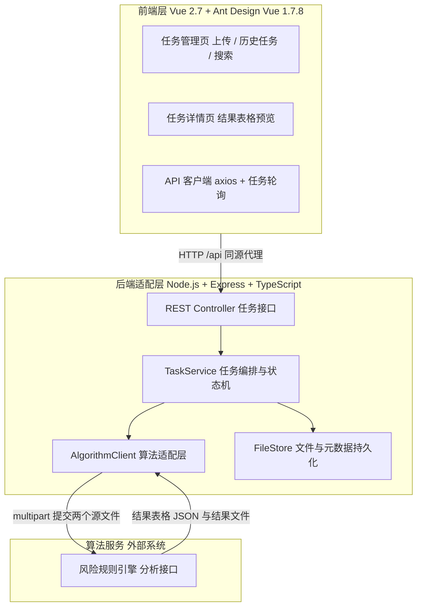
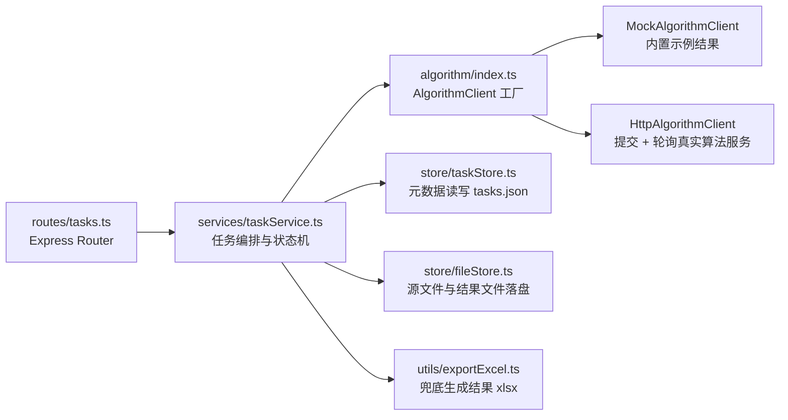
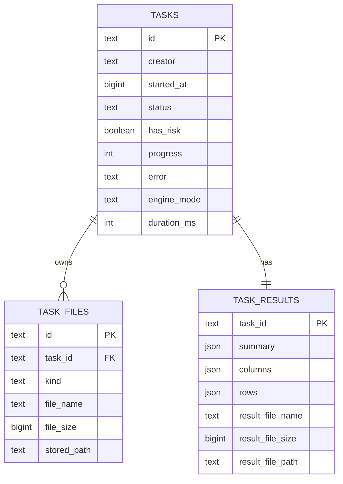

# 审计风险任务管理平台 · 技术架构文档

## 1. 架构设计

整体为「前端 + 后端适配层 + 外部算法服务」三段式。前端只负责收集用户任务与数据、提交后端、回显后端返回的结果表格；后端负责接收文件、编排任务状态、调用算法服务、存储结果并对外提供下载；**风险规则引擎由算法团队实现**，平台通过 `AlgorithmClient` 适配层对接，本期先提供 Mock 实现跑通全流程，算法契约确定后仅替换适配层实现即可。



## 2. 技术说明

- **前端**：Vue@2.7.16（Options API，SFC）+ ant-design-vue@1.7.8（Ant Design 的 Vue 2 版本）
- **前端构建**：Vite@4.5 + @vitejs/plugin-vue2@2.3；样式 tailwindcss@3.4 + PostCSS + Autoprefixer（含一层 antd 视觉覆盖）
- **前端路由**：vue-router@3.6（hash 模式）；HTTP 客户端 axios@1.x
- **后端**：Node.js 18+ / Express@4 / TypeScript / ESM（`tsx` 直接运行）；multer 接收 multipart 上传，axios 转发算法服务，xlsx 生成兜底结果文件，cors 处理跨域
- **工程运行**：`npm run dev` 一条命令并行启动前端（5173）与后端（8787）；Vite 通过 `server.proxy` 把 `/api` 代理到后端，避免跨域与鉴权复杂度
- **存储**：纯文件落盘（零外部服务）——上传文件 `api/storage/uploads/`，结果文件 `api/storage/results/`，任务元数据 `api/storage/tasks.json`；接口层已隔离，后续可平滑迁移到数据库
- **算法对接**：`ALGORITHM_MODE=mock|http`。`mock` 使用内置 Mock 实现（生成示例结果表格，保证全链路可演示）；`http` 使用 `HttpAlgorithmClient` 调用 `ALGORITHM_API_URL`
- **后端目录**：`api/`（`routes/` `services/` `algorithm/` `store/` `utils/`），与前端 `src/` 分离

### 2.1 环境变量（`api/.env`，附 `.env.example`）

| 变量 | 默认值 | 说明 |
| ---- | ------ | ---- |
| `PORT` | `8787` | 后端端口 |
| `ALGORITHM_MODE` | `mock` | `mock` 使用内置 Mock；`http` 调用真实算法服务 |
| `ALGORITHM_API_URL` | 空 | 算法服务提交地址，如 `http://10.0.0.21:9000/api/analyze` |
| `ALGORITHM_API_KEY` | 空 | 算法服务鉴权 Token（放入 `Authorization: Bearer`） |
| `ALGORITHM_TIMEOUT_MS` | `300000` | 单次分析超时时间 |
| `STORAGE_DIR` | `./api/storage` | 文件与元数据存储目录 |

## 3. 路由定义

| 路由 | 用途 |
| ---- | ---- |
| `/` | 任务管理页：新建任务区 + 历史任务区（含关键词搜索） |
| `/tasks/:id` | 任务详情页：分析概览 + 算法结果表格 + 下载与重启 |

## 4. API 定义

### 4.1 平台后端接口（`/api`）

```ts
type TaskStatus = 'running' | 'done' | 'failed'

interface FileMeta { name: string; size: number }

/** 算法返回的结果表格（统一结构，前端按 columns 动态渲染） */
interface ResultTable {
  summary: { label: string; value: string | number; tone?: 'danger' | 'warning' | 'info' | 'success' }[]
  columns: { key: string; title: string; type?: 'text' | 'number' | 'enum' | 'date'; width?: number }[]
  rows: Record<string, string | number | null>[]
}

interface AlgorithmResult {
  hasRisk: boolean | null
  table: ResultTable | null
  resultFile: { name: string; size: number } | null   // 算法回传的结果文件（已落盘）
}

interface AuditTask {
  id: string                                   // tsk_xxx
  creator: string                              // 发起人
  startedAt: number                            // 任务启动时间（时间戳）
  status: TaskStatus                           // 任务状态
  hasRisk: boolean | null                      // 是否发现风险；进行中为 null
  progress: number                             // 0-100
  files: { order: FileMeta; invoice: FileMeta }
  result: AlgorithmResult | null
  error?: string                               // 失败原因
  engine?: { mode: 'mock' | 'http'; durationMs: number }
}
```

| 方法 | 路径 | 说明 | 请求 / 响应 |
| ---- | ---- | ---- | ----------- |
| `POST` | `/api/tasks` | 新建任务并提交算法服务 | `multipart/form-data`：`orderFile`、`invoiceFile`、`creator` → `201 AuditTask`（初始 `status=running`） |
| `GET` | `/api/tasks` | 历史任务列表，按 `startedAt` 倒序 | → `AuditTask[]`（列表不含 `result.table.rows` 以减小体积，仅含汇总） |
| `GET` | `/api/tasks/:id` | 任务详情（含完整结果表格） | → `AuditTask` |
| `POST` | `/api/tasks/:id/restart` | 重启任务，重新提交算法服务 | → `AuditTask` |
| `GET` | `/api/tasks/:id/result-file` | 下载算法结果文件（算法未回传时由后端按结果表格生成 xlsx） | → `application/vnd.openxmlformats-officedocument.spreadsheetml.sheet` |
| `GET` | `/api/templates/:kind` | 下载模板（`kind` = `order` \| `invoice`） | → xlsx 文件流 |
| `GET` | `/api/health` | 健康检查 | → `{ ok: true, algorithmMode: 'mock' \| 'http', algorithmReachable: boolean }` |

任务状态机：`running → done`（算法返回成功）/ `running → failed`（超时、网络异常、算法返回非成功码、文件无法解析）；`failed | done → running`（重启）。

### 4.2 与算法服务的契约（`AlgorithmClient`）

后端对算法只有两个动作，适配层已按此抽象；算法团队只需实现 **提交** 与（可选）**轮询** 两个端点。

**① 提交分析（后端 → 算法）**

```
POST {ALGORITHM_API_URL}
Content-Type: multipart/form-data
Authorization: Bearer {ALGORITHM_API_KEY}

taskId=tsk_1730000000000
creator=张明
orderFile=<经销商订单信息.xlsx>
invoiceFile=<发票五要素.xlsx>
```

**同步返回（推荐，适合秒级分析）**

```json
{
  "code": 0,
  "message": "ok",
  "data": {
    "hasRisk": true,
    "summary": [
      { "label": "风险总数", "value": 9, "tone": "danger" },
      { "label": "高风险", "value": 4, "tone": "danger" },
      { "label": "中风险", "value": 3, "tone": "warning" },
      { "label": "低风险", "value": 2, "tone": "info" }
    ],
    "columns": [
      { "key": "riskLevel", "title": "风险等级", "type": "enum", "width": 110 },
      { "key": "riskType", "title": "风险类型", "type": "text" },
      { "key": "orderNo", "title": "订单号", "type": "text" },
      { "key": "dealerName", "title": "经销商名称", "type": "text" },
      { "key": "invoiceNo", "title": "发票号码", "type": "text" },
      { "key": "orderAmount", "title": "订单金额", "type": "number" },
      { "key": "invoiceAmount", "title": "发票金额", "type": "number" },
      { "key": "diffAmount", "title": "差异金额", "type": "number" },
      { "key": "remark", "title": "风险说明", "type": "text" }
    ],
    "rows": [
      { "riskLevel": "高", "riskType": "发票缺失", "orderNo": "SO20240001", "dealerName": "华信商贸", "invoiceNo": "-", "orderAmount": 128000, "invoiceAmount": 0, "diffAmount": 128000, "remark": "未匹配到对应发票" }
    ],
    "resultFile": { "name": "分析结果.xlsx", "contentBase64": "UEsDBBQ..." }
  }
}
```

**异步返回（适合分钟级分析，可选实现）**：响应体为 `{ "code": 0, "data": { "async": true, "jobId": "job_888" } }`，后端转为轮询 `GET {ALGORITHM_API_URL}/jobs/{jobId}`，直至返回 `status: "done"` 且数据结构同上（`status: "failed"` 则任务置失败）。轮询间隔 2s，上限由 `ALGORITHM_TIMEOUT_MS` 控制。

**约定说明**
- `code = 0` 视为成功，非 0 时 `message` 直接作为任务的失败原因回显到页面。
- `columns` 是渲染唯一依据：前端不硬编码任何风险列，算法增删列无需改前端代码。
- `resultFile.contentBase64` 可选；缺省时后端用 `columns + rows` 生成 `分析结果.xlsx` 兜底，保证【下载】始终可用。

## 5. 服务端架构图



## 6. 数据模型

### 6.1 数据模型定义

本期元数据以 JSON 落盘，逻辑模型与未来数据库表一致：



### 6.2 数据定义语言

**本期实现（文件落盘）**：`api/storage/tasks.json` 为 `AuditTask[]` 的 JSON 数组，上传文件存 `api/storage/uploads/{taskId}/`，结果文件存 `api/storage/results/{taskId}/`。

**后续迁移到数据库时可直接执行**：

```sql
-- 历史任务主表
CREATE TABLE IF NOT EXISTS tasks (
  id           TEXT PRIMARY KEY,
  creator      TEXT        NOT NULL,
  started_at   BIGINT      NOT NULL,
  status       TEXT        NOT NULL CHECK (status IN ('running', 'done', 'failed')),
  has_risk     BOOLEAN,
  progress     INT         NOT NULL DEFAULT 0,
  error        TEXT,
  engine_mode  TEXT,
  duration_ms  INT
);

-- 任务源文件
CREATE TABLE IF NOT EXISTS task_files (
  id          TEXT PRIMARY KEY,
  task_id     TEXT NOT NULL,
  kind        TEXT NOT NULL CHECK (kind IN ('order', 'invoice')),
  file_name   TEXT NOT NULL,
  file_size   BIGINT NOT NULL DEFAULT 0,
  stored_path TEXT
);

-- 算法结果（按任务一对一）
CREATE TABLE IF NOT EXISTS task_results (
  task_id          TEXT PRIMARY KEY,
  summary          JSONB NOT NULL DEFAULT '[]'::jsonb,
  columns          JSONB NOT NULL DEFAULT '[]'::jsonb,
  rows             JSONB NOT NULL DEFAULT '[]'::jsonb,
  result_file_name TEXT,
  result_file_size BIGINT,
  result_file_path TEXT
);

CREATE INDEX IF NOT EXISTS idx_tasks_started_at ON tasks (started_at DESC);
CREATE INDEX IF NOT EXISTS idx_tasks_creator    ON tasks (creator);
CREATE INDEX IF NOT EXISTS idx_tasks_status     ON tasks (status);

-- 初始化示例数据
INSERT INTO tasks (id, creator, started_at, status, has_risk, progress, engine_mode, duration_ms)
VALUES
  ('tsk_1730000000000', '张明', 1730000000000, 'done',   true,  100, 'mock', 1840),
  ('tsk_1730001000000', '李静', 1730001000000, 'done',   false, 100, 'mock', 1520),
  ('tsk_1730002000000', '王涛', 1730002000000, 'failed', NULL,   45, 'http', 0);
```

### 6.3 结果表格与渲染约定

- 后端**不解释**业务字段含义，`columns` / `rows` 原样透传与存储；前端的「结果表格」「分析概览卡片」均按 `columns`、`summary` 动态生成。
- `columns[].type` 影响渲染：`number` 右对齐并千分位格式化，`enum` 染色为胶囊标签（高风险/中风险/低风险/无风险按语义色），`date` 统一格式化。
- 列表接口只返回 `summary` 不返回 `rows`，避免历史任务列表响应过大；完整表格仅在任务详情接口返回。
